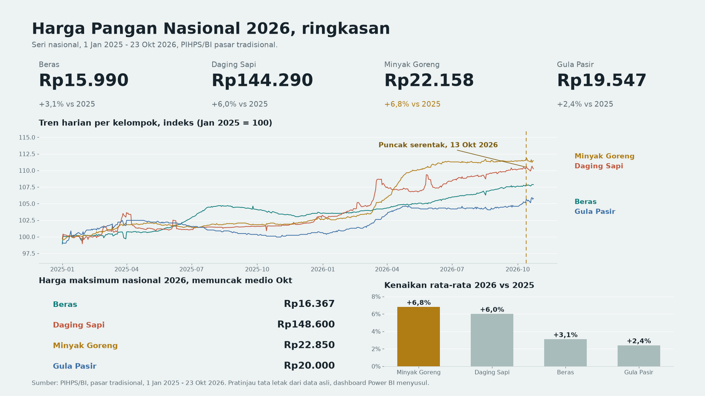

# Analisis Harga Pangan Nasional Indonesia 2026

Analisis harga pangan pokok nasional Indonesia periode **1 Januari 2025 sampai 19 Oktober 2026** menggunakan data harian resmi **PIHPS (Pusat Informasi Harga Pangan Strategis) / Bank Indonesia** — pasar tradisional, 13 komoditas pangan, 34 provinsi.

> **Sumber data:** API publik PIHPS/BI (`bi.go.id/hargapangan`), diakses 2026-10-19/20. Data diambil langsung (read-only, tanpa API key) lewat `scripts/fetch_pihps.py`. Tidak ada dataset pihak ketiga yang disalin.

## Ringkasan temuan

Periode 1 Jan 2025 – 19 Okt 2026, pasar tradisional, harga nasional (Rp/kg):

| Kelompok | Rata-rata 2025 | Rata-rata 2026 | Perubahan | Puncak |
|---|---|---|---|---|
| Beras | 15.515 | 15.983 | **+3,0%** | 16.367 (13 Okt 2026) |
| Daging Sapi | 136.093 | 144.214 | **+6,0%** | 148.600 (13 Okt 2026) |
| Minyak Goreng | 20.753 | 22.146 | **+6,7%** | 22.850 (13 Okt 2026) |
| Gula Pasir | 19.086 | 19.539 | **+2,4%** | 19.950 (13 Okt 2026) |

- **Minyak goreng naik paling tinggi** (+6,7% YoY) dan **paling volatil** (CV 4,3%, dipimpin Minyak Goreng Curah yang melonjak ke Rp20.750 pada 4 Jun 2026). Gula Pasir paling stabil (CV 1,3–2,1%).
- **Lonjakan serentak medio Oktober 2026**: keempat kelompok mencapai titik tertinggi pada 13–14 Okt 2026 — pola yang sama terlihat pada proyek Harga Cabai (puncak 12 Okt 2026), mengindikasikan tekanan harga pangan luas, bukan komoditas tunggal.
- **Disparitas antarprovinsi 36–41%**: Beras termurah NTB (Rp13.622) vs termahal Kalimantan Tengah (Rp19.094), selisih 40,2%; Daging Sapi NTT (Rp117.522) vs Kalimantan Selatan (Rp165.463), selisih 40,8%; Minyak Goreng Kepulauan Riau vs Gorontalo (36,3%); Gula Pasir Sulawesi Selatan vs Papua (37,1%).
- **Efek Ramadan kecil**: harga beras naik tipis 0,2–0,4% selama Ramadan 2025 dan 2026 dibanding 30 hari sebelumnya, lalu lanjut naik ringan sesudahnya — tidak ada spike tajam.

Seluruh angka dihitung ulang dari `data/raw/*.csv`; detail per komoditas ada di `findings.json`.

## Pratinjau dashboard



Pratinjau tata letak halaman 1 (Ringkasan Nasional) yang dibuat langsung dari
data asli repo ini. Kit Power BI (star schema, DAX, layout 4 halaman) ada di
`powerbi/`; GitHub tidak bisa me-render file `.pbix`, jadi pratinjau ini yang
tampil di halaman repo sampai dashboard-nya selesai dirakit di Power BI Desktop.

## Struktur repo

```
├── README.md                     # dokumen ini
├── data/
│   ├── raw/
│   │   ├── harga_pangan_nasional.csv   # seri nasional harian (level 0)
│   │   ├── harga_pangan_provinsi.csv   # seri provinsi harian (level 1)
│   │   └── pihps_chunks/               # respons mentah API per komoditas-provinsi
│   └── SOURCES.md                # dokumentasi sumber per berkas
├── scripts/
│   ├── fetch_pihps.py            # pengambil data API PIHPS/BI
│   ├── fetch_worker.py           # worker paralel untuk fetch
│   ├── analyze.py                # analisis + findings.json + charts
│   └── load_to_sqlite.py         # bangun star schema SQLite (opsional, .db tidak di-push)
├── sql/queries.sql               # 8 query analitik
├── charts/                       # 12 chart PNG
├── findings.json                 # angka-angka kunci (dihitung ulang dari data)
├── powerbi/                      # kit Power BI: CSV star schema, DAX, layout, panduan
├── Portofolio-Analisis-Harga-Pangan.pptx  # deck portofolio 10 slide 16:9
└── Modul-Analisis-Harga-Pangan.pdf        # modul belajar (pro pemula)
```

## Metodologi

1. **Pengambilan data**: 13 komoditas daun × 34 provinsi = 442 panggilan API; tiap respons berisi baris nasional (level 0) + baris provinsi (level 1). Baris nasional dideduplikasi per (tanggal, komoditas).
2. **Model data**: level nasional dan provinsi disimpan di tabel fakta **terpisah** sejak awal (`fact_nasional`, `fact_provinsi`) + dimensi `dim_komoditas`, `dim_provinsi`, `dim_tanggal`. Tidak ada baris agregat di dalam tabel detail, sehingga measure DAX/aggregasi SQL selalu membaca satu grain tanpa guard khusus.
3. **Kelompok komoditas**: Beras (6 kualitas), Daging Sapi (2), Minyak Goreng (3), Gula Pasir (2). Tidak ada komoditas daun untuk telur ayam, daging ayam, atau bawang merah/putih di API ini — hanya agregat kategori — sehingga tidak dipakai (tidak dikarang).
4. **Satuan**: Rp/kg, pasar tradisional. Tanda "-" (tidak ada laporan hari itu) diperlakukan sebagai data hilang, bukan nol.

## Keterbatasan

- Cakupan = pasar tradisional yang terpantau PIHPS; tidak mencakup pasar modern/e-commerce.
- Beberapa pasangan komoditas-provinsi tidak memiliki seri (tercatat sebagai GAP saat fetch) — wajar untuk komoditas yang tidak diperdagangkan/dilaporkan di provinsi tersebut.
- Harga adalah harga laporan harian, bukan harga transaksi tiap pedagang.

## Lisensi data

Data © Bank Indonesia / PIHPS (data publik). Kode analisis dalam repo ini bebas dipakai dengan atribusi.
